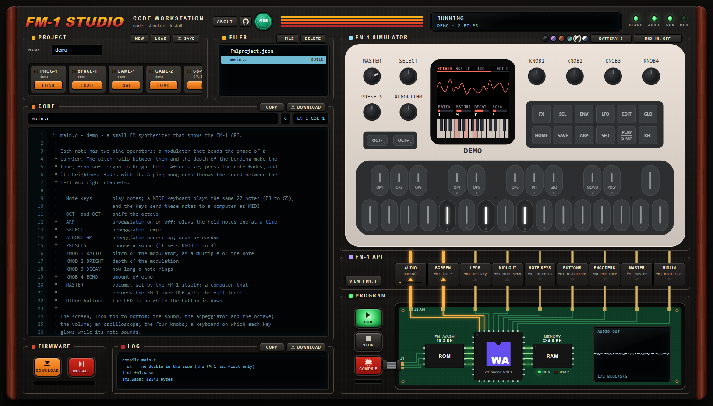

# FM-1 Studio

[](https://fm1studio.com)

A code editor, compiler, simulator and installer for the M-VAVE FM-1 synthesizer that runs in the browser: **[fm1studio.com](https://fm1studio.com)**.

Write a program in C (or ask your AI to write it), press COMPILE, and play it on a simulated FM-1. 
The compiler, the program and the simulator all run in the page. There is no server side and nothing to install. 
It is a simulation of the FM-1 API, not an emulation of the CPUs. The same compiler, for the FM-1's processor, 
makes an installable package for a real FM-1 from a project (DOWNLOAD), and an installer writes it to an FM-1 
over USB (INSTALL). Code that works in this simulator does not guarantee it will work on a real FM-1.

- **Code editor** with a file list, syntax colours and projects of more than one file.
- **Vibe coding**: prompts with which an AI chat writes a program from your idea. C code that is pasted
  on the page becomes a project.
- **Simulator compiler**: clang 23.1.5 and wasm-ld for WebAssembly (pi32v2-llvm, as WebAssembly), in a Web
  Worker. The output is one WebAssembly module. It compiles a program as the FM-1 takes it: C, `float`
  only, and the C library of the FM-1.
- **FM-1 simulator**: the front panel with its 240 x 240 screen, 27 note keys, 14 buttons, 7 encoders,
  the MASTER pot and the LEDs, in the six colours of the device. The LEDs light the legends of the keys,
  with the levels of a real FM-1 (a glow, a mid level, fully lit, a breath), and PLAY has its red and its
  green LED.
- **Sound** on the audio thread of the browser (an AudioWorklet), with a scope and a level meter.
- **MIDI input** from the keyboards and controllers of the computer (Web MIDI).
- **Firmware gallery**: loads a demo project, or the source code of open-source FM-1 firmware from
  GitHub, compiles it and runs it.
- **Firmware compiler**: the same clang, with ld.lld, for the FM-1's processor, in a second Web Worker.
  It makes a `.fwsc` package of a project for a real FM-1.
- **Installer**: fm1-base's installer writes the package to an FM-1 over USB MIDI (Chrome or Edge).

## The compilers

The simulator compiler and the firmware compiler are one program: LLVM's clang and linkers, built as
WebAssembly with two targets. It runs in the browser.

| | Simulator compiler | Firmware compiler |
| --- | --- | --- |
| What | clang 23.1.5 and wasm-ld, for WebAssembly | clang 23.1.5 and ld.lld, for the FM-1's processor (JieLi pi32v2) |
| Project | [pi32v2-llvm](https://github.com/jvitkauskas/pi32v2-llvm) by Julius Vitkauskas: LLVM with a target for pi32v2, which its author calls experimental | The same |
| Version | Commit `60b0340f47083cf088903030a9b55d8a65525dde`, release `pi32v2-23.1.5-5` | The same |
| Built by | This repository: `firmware/web/build_compiler.sh` builds it from source with Emscripten 7.0.0, with LLVM's WebAssembly target besides pi32v2 | The same |
| Loaded from | `src/fwsc` of this site: `llvm.js`, `llvm.wasm` (53 MB), `platform.json` | The same files, loaded one time for both |
| Runs in | `compiler-worker.js` in `src/index.html` | `firmware-worker.js` in `src/index.html` |
| Makes | `fm1.wasm`, which the simulator runs | A `.fwsc` package for a real FM-1 |
| Licence | Apache-2.0 with LLVM exceptions; Emscripten's runtime and musl: MIT and others | The same |

The page loads the compiler when it opens, and gives it to the firmware worker at the first DOWNLOAD or
INSTALL. The WebAssembly logo in the PROGRAM panel and the one in the FIRMWARE panel name the compiler in
their hints.

The simulator compiler compiles an `fm1.h` program as the firmware build does: C only, with the C library
of the FM-1, and `float` only (see "Write a program"). A firmware of the gallery has its own FM-1 inside,
and gets web-libc: a small C library of FM-1 Studio, in the page (see "How it works").

[src/fwsc/README.md](src/fwsc/README.md) lists all parts of the compiler, and
[firmware/web/README.md](firmware/web/README.md) tells how to build it again and how to check its
packages. On a computer, `firmware/build.sh` builds the same kind of package with JieLi's own compiler (clang 4.0.1 for
pi32v2, a binary from JieLi's server, without source code): [firmware/README.md](firmware/README.md).

## Use

Open the page. The first time, it downloads the compiler (53 MB). It then compiles the demo project
and runs it. Browsers block sound until a click or a key press, so click the page one time.

| Control | How |
|---|---|
| Note keys, buttons | Click or touch |
| Encoders, MASTER | Mouse wheel, or drag up and down |
| Notes C4 to F5 | Computer keys `A` to `'` (white keys) and the row above (black keys) |
| OCT- and OCT+ | Computer keys `Z` and `X` |
| Compile and run | The COMPILE button, or `Ctrl`+`Enter` |
| MIDI | The MIDI IN button asks the browser for permission. A second click switches MIDI IN off |
| Battery | The BATTERY button sets the level that the program reads: 3 (full) to 0 (empty), or USB |

A project is a name and a set of text files. SAVE downloads it as a zip file and LOAD reads one back.
The name (NAME) has letters, digits, space, `+` and `-`, 14 characters at most: on a real FM-1 it is the
name of the FM-1 over USB, and its crash and safe-mode screens show it in capitals. It also gives the names
of the zip file and of the package. A loaded zip
file gives its name, with a space for each other character.
For a firmware of the gallery, SAVE first opens a dialog: CONFIRM that the firmware is the work of its
authors and that you keep to its licence, and the zip file downloads; CANCEL saves nothing. DOWNLOAD and
INSTALL ask the same.
A project zip file that is dropped on the page loads too. A file `main.c` that is dropped on the page
makes a new project with the name "no name": that `main.c`, and the `fm1project.json` of the demo
project. C code with `#include "fm1.h"` that is pasted on the page with `Ctrl`+`V`, outside the editor
and the text fields, does the same. Of a pasted answer of an AI chat, the page takes the longest code
block.
PROG-1, the first card of the gallery, loads a demo project in place of the project: a progressive rock
band in an FM-1, by Hans Dam. SPACE-1, the second card, loads an original piece in the spirit
of space sounds and synth bass, with laser shots, a flying saucer and sonar pings on the buttons. 
GAME-1, the third card, loads a game: NEON REEF, a vertical shooter. Fly with the computer keys `A`, `W`, `S` and `D`, and fire with `J`.
GAME-2, the fourth card, loads SWOOPERS, an arcade shooter with a swarm of aliens that dive at you. Move
with the computer keys `A` and `D`, and fire with `J`.
The page keeps nothing between visits: save a project before you close the page. The simulator keeps the
store of the programs (`fm1_store_save`) while the page is open, also for the next program, as an FM-1
keeps its flash; a reload of the page empties it.

## Write a program

A program is written against `fm1.h` (the VIEW FM1.H button shows it, with the full documentation). It
defines three functions:

```c
#include "fm1.h"

void setup(void) { }                           /* one time, before the first audio block */
void audio(int32_t *out, int frames) { }       /* each block: 256 stereo frames, signed 24-bit */
void loop(void) { }                            /* again and again: controls and screen */
```

The API gives the program:

| Part | Functions |
|---|---|
| Screen, RGB565 | `fm1_lcd_fill_rect`, `fm1_lcd_blit` |
| Keys and buttons | `fm1_in`, `fm1_input_edges`, `fm1_input_note_edges` |
| LEDs, with levels, and PLAY's red LED | `fm1_led_key`, `fm1_led_level`, `fm1_led_dim_low` |
| Encoders | `fm1_enc_take` |
| MASTER pot | `fm1_master` |
| Battery level | `fm1_battery` |
| MIDI input | `fm1_midi_take` |
| MIDI output | `fm1_midi_send` |
| Store: data that stays when the FM-1 is off | `fm1_store_load`, `fm1_store_save` |

The screen and input functions have the names and signatures of
[felucca-bsp](https://github.com/hugelton/felucca-bsp). The demo project `main.c` uses all of the API but
the battery and the store: a small FM synthesizer with an arpeggiator, an echo and its own screen.
`testprograms/store-test` tests the store, `testprograms/battery-test` the battery level, and
`testprograms/midi-test` the MIDI input and output, in the simulator and on a real FM-1.

`fm1_midi_send()` sends a MIDI message to the computer, over the USB cable: the FM-1 is a USB MIDI device
there. It sends the channel messages, and clock, start, continue and stop. An FM-1 with an `fm1.h` program
sends nothing on its own: a note key sends a note only when the program sends one. The demo project sends
its note keys as notes on channel 1 (F3 to G5, the notes that it takes from a MIDI keyboard), so an FM-1
with the demo plays the demo in the simulator when MIDI IN is on. In the simulator, the MIDI OUT lane of
the FM-1 API shows each message; the page does not send it to a MIDI device of the computer.

`fm1_battery()` gives the battery level as the FM-1 measures it: 0 (empty) to 3 (full), 4
(`FM1_BATTERY_USB`) while a computer powers the FM-1 over USB, and -1 in the first moments after
power-on, before the first measurement. In the simulator, the BATTERY button sets the level, and
`fm1_battery()` gives -1 in `setup()` and for the first half second.

COMPILE compiles a program as the firmware build does, so that a program that runs here also builds for
a real FM-1:

- **C only.** A `.cpp` file stops the compile.
- **The C library of the FM-1**: the headers of `firmware/adapter/libc`, with the `float` maths and the
  string functions, and no `malloc`, `printf` or `stdio.h`. Its `fm1_libc.c` is linked into each program,
  so `sinf` gives the same values here as on the FM-1.
- **`float` only.** Each file is also compiled for the FM-1, with the options of the firmware build, and
  linked as there. When the code that `setup()`, `audio()` and `loop()` reach needs a routine for
  `double`, the compile stops, and the LOG panel names the functions: write `0.5f`, `sinf`, `powf`.

### Vibe coding

You do not have to write the program yourself. The VIBE button makes a prompt for an AI chat
from your idea: you describe a synth, a piece or a game, and the AI writes `main.c`.

1. Write the idea in the dialog, or start from one of its examples: DRUM-1, STRING-1, PIECE-1 or GAME-2.
2. COPY the prompt, and give it to an AI chat. Use a strong AI model: a weaker one makes more mistakes.
   The prompt has the idea, the rules for a program on the FM-1, and all of `fm1.h`.
3. Copy the code of the answer, and paste it on the page with `Ctrl`+`V`, outside the editor. The page
   makes a new project of it, compiles it and runs it. A copy of the whole answer also works: the page
   takes its longest code block. When the AI gives the file `main.c`, drop it on the page.
4. Tell the AI what to change. When a compile fails, copy the text of the LOG panel to the AI.

The rules in the prompt are those of a real FM-1: C, `float` and no `double`, no `malloc` and no
`printf`, a fast `audio()` that does not draw, a `loop()` that returns soon, LEDs that show which
buttons do something, and a save to the store only when the user asks for it or after a pause. 
COMPILE refuses a program that breaks one of the first three. An AI makes mistakes: test the program in 
the simulator, and read "On a real FM-1" before you install it.

### On a real FM-1

The DOWNLOAD button makes a `.fwsc` package of the project with the firmware compiler, and downloads it.
It uses the compiler that the page loaded for COMPILE: a package takes some seconds. The NAME of the
project gives the name of the FM-1 over USB, and of the package (a name without a letter or a digit
gives "project"). An adapter makes the functions of `fm1.h` from
[fm1-base](https://github.com/charlesvestal/fm1-base) and felucca-bsp. The program must be C, with `float`
and no `double`; the LOG panel tells when a program does not fit the FM-1.

The FM-1 has no start screen of its own then: the screen stays black until `setup()` draws. The store of
`fm1.h` is fm1-base's store in the flash, from 0x97000 to 0xB6FFF: two 4 KiB sectors for each slot, which
a save writes in turn, with a CRC, so that a save that is cut off leaves the save before. An install of a
package does not change that part of the flash: the next program finds the data there. Other firmwares can
use the same part, and the firmware of M-VAVE writes all of the flash.

**FM-1 Studio was tested on a real FM-1, with all its features**: DOWNLOAD and INSTALL, for `fm1.h`
programs and for each firmware of the gallery in the table of "The gallery's firmware on a real FM-1".
"Which FM-1" tells which FM-1, and what was not tried. Read this section to its end before you install a
package.
[firmware/README.md](firmware/README.md) tells what a program must keep to on the FM-1.

The folder `firmware` builds the same kind of package on your own computer, from a project zip (the file
that SAVE gives), with JieLi's own compiler: `firmware\build.cmd PROJECT.zip` on Windows (in WSL),
`firmware/build.sh PROJECT.zip` on Linux. That build also runs the program in fm1-base's host simulator.

#### Install the package

The INSTALL button builds the project and writes the package to an FM-1, over USB MIDI. Its dialog is a
device of its own, with a panel for each step, from left to right. A step can be done when the step
before it is done:

1. **Read.** The page makes the package of the project and checks it. You read what an install does,
   and agree. For a firmware of the gallery, you also agree that it is the work of its authors and that
   you keep to its licence; the box links to its repository. The dialog tells you to work
   with [M-Flasher](https://github.com/jvitkauskas/m-flasher) first: make a backup, check the flash chip and
   the boot loader, and install [m-bootloader](https://github.com/jvitkauskas/m-bootloader).
2. **Connect.** Connect the FM-1 with a USB cable that carries data, and let it run as it is. CONNECT
   asks the browser for MIDI with SysEx messages, finds the FM-1, and tells which firmware it runs. It
   asks only the MIDI ports with a usual name of an FM-1: those of fm1-base's installer ("FM-1", "Felucca"
   and more), and "JIANT", the port of JIANT (`PORT_NAMES_MORE` in `src/index.html`). When no FM-1
   answers, it lists the other ports, each with a TRY button. A firmware that runs does not tell the
   boot loader. To see it, start the FM-1 in m-bootloader's MIDI mode
   (version 2.2 or later: hold PLAY at power-on, then choose MIDI MODE). There, CONNECT also shows what
   M-Flasher shows of the boot loader and the flash: the version of m-bootloader, the flash chip, the chip
   key and the ID of the unit (command `0x12` of m-bootloader's `docs/SPEC.md`, 11.6). The page sends that
   command only to an FM-1 that answers as m-bootloader (`ota-FM-1_900`): M-VAVE's firmware takes the same
   kind of message, and some of its commands erase the flash.
3. **Install.** INSTALL NOW starts the install. The firmware on the FM-1 checks the package and starts
   the update loader of the package. The loader writes the program, and the FM-1 starts again. The
   page then asks the FM-1 for its identity and compares it with the package. The panel shows these
   stages, each with a lamp, the progress, the time of the install, the data that the FM-1 asked for,
   the time since its last message, and a light (DATA) that blinks with its messages.

The button needs Chrome or Edge (Web MIDI), and the page from `https:` or `localhost`. Do not disconnect
the cable during the install, and keep the page in front: the installer waits with timers, and a browser
slows down the timers of a page that is not in front, so that the install can take much longer, or stop.
During the install, a red bar below the head of the dialog says DO NOT DISCONNECT · KEEP THIS PAGE IN
FRONT, the page keeps the screen of the computer on (when the browser allows it), the title of the page
shows the progress, and the dialog tells how long the page was not in front (AWAY). An install that stops after the FM-1 went to update mode can continue:
connect the cable again and go through the steps again. The code that talks to the FM-1 is fm1-base's
own installer, not changed: [src/install/README.md](src/install/README.md). INSTALL is off while a
firmware of the gallery is open that the firmware compiler cannot build (see "The gallery's firmware on a
real FM-1").

##### Back to the firmware of M-VAVE

The INSTALL dialog installs the program of the project only. To put the firmware of M-VAVE back, download
[FM-1.fwsc](https://yms-file-store.oss-cn-hongkong.aliyuncs.com/software/firmware/FM-1.fwsc) from M-VAVE
(version 16 in November 2026) and install it with one of the other tools below. The update loader of
M-VAVE writes all of the flash memory, also the boot loader. We do not know if version 15 knows the newer
flash chip (see "Which FM-1"): use the file from the link.

##### Other tools

Other tools install the file that DOWNLOAD gives. They are felucca-bsp's and M-VAVE's, not ours:

- `tools/fm1_install.py PACKAGE.fwsc` of felucca-bsp installs over USB MIDI. It needs Python with `mido`
  and `python-rtmidi`. Run it in Windows, not in WSL: WSL does not see the FM-1.
- felucca-bsp's notes say that M-VAVE's own updater (M-UPGRADE) takes such packages too.

The package of an `fm1.h` program holds the program and fm1-base's update loader; that of a firmware of
the gallery holds the firmware and its own update loader. After the install, the FM-1 runs only this
program, until you install another firmware.

#### Which FM-1

The FM-1 was made with two flash chips: the Puya P25Q80 (ID 856014) and, in units sold since autumn 2026,
the UC25HQ80 (ID B36014). The fm1-base version that a package is built on takes both
(`device/fm1_flash_ok.h`), and so does the package. A firmware that knows only the first chip starts on a
unit with the second one, but then cannot be replaced over USB: that is why this matters.

The update loader in the package writes only the program area of the flash, not the boot loader below
it. M-VAVE's stock firmware exists as V15 and V16, each with its own boot loader. fm1-base says it starts
under either. [m-bootloader](https://github.com/jvitkauskas/m-bootloader) is another boot loader, in place
of M-VAVE's.

The packages of FM-1 Studio were tested on one FM-1: the newer chip (B36014), with m-bootloader
2.4-395e6cc, installed with M-Flasher (November 2026). We did not try a package on the first chip, or
under the boot loader of V15 or V16. The store of `fm1.h` was tested on that FM-1 with
`testprograms/store-test` (November 2026): all its tests pass, and the data stays after the FM-1 is off.
The screen stays black at power-on until the program draws. The battery level of `fm1.h` (`fm1_battery`)
was tested on that FM-1 with `testprograms/battery-test` (November 2026), and works. The MIDI output of
`fm1.h` (`fm1_midi_send`) was not tried on an FM-1 yet: `testprograms/midi-test` is the program for that.

#### If it goes wrong

This is what fm1-base and felucca-bsp say about their own safety nets. We did not try them.

- A firmware built on fm1-base keeps the update entry: an installer can replace it while it runs.
- **REC held at power-on** goes to the chip's own update mode, if the firmware starts at all. That mode
  is the one that `fm1_rescue` (below) talks to: do not go there without need.
- After two starts that fail, the FM-1 goes to a safe mode that makes no sound and takes an update. If
  safe mode fails too, it goes to the chip's update mode.
- `fm1_install.py FM-1.fwsc` of felucca-bsp, with M-VAVE's official file, puts the stock firmware back
  (see "Back to the firmware of M-VAVE" above).
- For an FM-1 that is in the chip's update mode and takes nothing else, felucca-bsp has `fm1_rescue`.
  That tool is for macOS only. We know of no such tool for Windows.

Keep M-VAVE's `FM-1.fwsc` on your computer before you install anything.

#### The gallery's firmware on a real FM-1

The firmware compiler can build the firmwares of the gallery whose `fm1project.json` has a `device` part
(the column "Real FM-1" of the gallery's table in ABOUT). That part tells the firmware worker to do the
steps of the firmware's own `tools/build.py`, with the files of the project: changes that you make in its
files go into the package. The package has the firmware's own update loader and identity:

| Firmware | Build (`device`) | Package | Identity | Same bytes | On a real FM-1 |
| --- | --- | --- | --- | --- | --- |
| CS-1 0.3.4 | `"dinghy"`, with a change for the newer flash chip | `cs1.fwsc` | `FM-1_950` | Yes | Tested |
| FM-106 1.0 | `"dinghy"`, without Bluetooth, with its boot stub | `fm106.fwsc` | `FM-1_907` | Yes | Tested |
| AURORA 0.9.1 | `"dinghy"` | `aurora.fwsc` | `FM-1_4747` | Yes | Tested |
| FMINI-1 v2.5.12 | `"felucca"` | `fmini-1-fm1-2.5.12.fwsc` | `FM-1_900`, as its releases | Yes | Tested |
| GR!MM v2.0.2 | `"dinghy"`, as its release build (`--release 2.0.2`), with a change for the newer flash chip | `grimm-2.0.2.fwsc` | `FM-1_966`, as its releases | Yes | Tested |
| FELUCCA v1.8.2 | `"felucca"`, as its release build (`--release 1.8.2`) | `felucca-1.8.2.fwsc` | `FM-1_918`, as its release | Yes | Tested |
| SLOOP v2.8.5 | `"felucca"`, without the size pass | `sloop-2.8.5.fwsc` | `FM-1_900`, as its releases | Yes | Tested |
| SKIFF v2.5.1 | `"felucca"`, as its release build (`--release 2.5.1`), with a change for the firmware compiler | `skiff-2.5.1.fwsc` | `FM-1_725`, as its release | Yes | Tested |
| JIANT v0.9.18 | `"felucca"`, with its hot RAM code and layout, with changes for the firmware compiler and the newer flash chip | `jiant-0.9.18.fwsc` | `FM-1_900`, as its releases | Yes | Tested |
| X0X v1.3 | `"x0x"`, as its release build (`--release 1.3`) | `x0x-1.3.fwsc` | `FM-1_9010300`, as its release | Yes | Tested |

These are not the released packages: the authors build with JieLi's compiler, FM-1 Studio with the
firmware compiler. "Same bytes": unchanged and with a change, the page's package is the same bytes as the
one that the firmware's own `build.py` makes with the firmware compiler, and that build passes all its
checks (`firmware/web/reference_device.sh`). "Tested": the page's package was installed and played on the
FM-1 of "Which FM-1".

**The page builds FM-106 without Bluetooth.** FM-106's own build links JieLi's closed Bluetooth libraries
(with link-time optimisation, in Docker); the page does the build that its `build.py` makes with
`FELUCCA_BLE=0`, which has no Bluetooth MIDI or audio (in `device`: its `"flags"`, and one core with
`"dualCore": 0`). FM-106 1.0 takes both flash chips. It has a boot stub in front of the app (`firmware/stub`, `"stub": true`):
the chip's boot code starts the stub on every start, and the
stub starts the app only when the commit marker that the packer writes is right. `firmware/stub/stub.lock`
has the hash of the stub that JieLi's compiler made. The page's stub, from the firmware compiler, is another
one, and the log says so, as FM-106's `build.py` does: an install then also writes the flash sector of
the stub.

**The gallery's CS-1 and GR!MM have a change for the newer flash chip.** CS-1 0.3.4 and GR!MM 2.0.2 as
released know only the first chip (`0x856014` in `platform.c`, `recovery.c` and `loader/loader.c`), and
The Firmware Hub lists them so. On a unit with the newer chip, their update loader does not write (the
install stops, and the firmware that was there stays), and the firmware cannot keep its settings or take
an update over USB. AURORA, on the same platform (Dinghy), takes both chips: `FL_JEDEC_OK` in its
`hal/fm1_flash_id.h`, used in the same three places. The `patches` of the two entries make the same
change when the page loads the firmware (`flashChipPatches` in `src/index.html`): `FL_JEDEC_OK` in
`hal/fm1_flash.h`, and the three checks. Each changed file says so at its top. CS-1's update loader is
then the same bytes as AURORA's.

**GR!MM in the browser and on the FM-1.** GR!MM's main loop does not return, so for the browser the page
changes it to one turn of the loop for each call. Those changes are in `#ifdef GRIMM_WEB`, which only the
browser build defines: the build for a real FM-1 compiles `grimm.c` as released (its package is the same
bytes with `grimm.c` as released). GR!MM's `build.py` also checks the depth of the stacks from the
disassembly (`tools/stack_check.py`, not in the page). With this compiler, that check stops at two
functions that it does not know to call through a pointer: `fl_erase4k`, which calls the flash driver's
RAM code as the functions that the check knows do, and `knob_param`, whose jump table has bytes that the
disassembler shows as a call. With those two known, the check passes with 22 KB of the user stack and
6 KB of the system stack free. Its build keeps 4 KiB of RAM free (`"ramFree": 4096`).

**Felucca and FMINI-1: the `"felucca"` build.** FMINI-1 is made from Felucca, and the `build.py` of both
has more steps than AURORA's: the headers in `build/gen` (in the page: from the extras file, which the
firmware's own generators made), the code of the second core (`fm1_cpu1.S`), and a size pass. That pass
compiles the unity file `felucca.c` to LLVM IR, gives LLVM's `minsize` to the functions of the main loop
(those of the files that `tools/size_fns.py` names, but not the functions that an interrupt can run), and
then compiles the IR at `-Os`. The firmware worker's `"felucca"` build does these steps; `"size"` in
`device` is the list of files of `size_fns.py`. Felucca's hardware layer is in three folders, in this
sequence: its own `firmware/hal`, and the chip and board folders of the felucca-bsp submodule
(`firmware/bsp`); `"hal"` in `device` names them. Both take both flash chips (FMINI-1: `FL_JEDEC_OK` in
`hal/fm1_flash_map.h`; Felucca 1.8.2: `project.c`).

**SLOOP: the `"felucca"` build without the size pass.** SLOOP is made from Felucca too. Its `build.py`
compiles all of `felucca.c` at `-Os` (no `"size"`), and does not keep 4 KiB of RAM free as Felucca's does
(`"ramFree": 0`). When the image does not fit the flash, it builds again with the boot logo as text
(`FELUCCA_LOGO_TEXT=1`, 4.6 KB less); the page does not: such a link stops with the linker's error. Add
`"FELUCCA_LOGO_TEXT=1"` to `"define"` of `device` for that build. With the firmware compiler, SLOOP 2.8.5
leaves 21 KB of the flash free. SLOOP 2.8.5 takes both flash chips (`hal/fm1_flash_id.h`).

**SKIFF: the `"felucca"` build, with a change for the firmware compiler.** SKIFF is made from Felucca too,
and is built as its release (`--release 2.5.1`: identity `FM-1_725`, the version string `v2.5.1`, no
serial console). Its `build.py` has more steps, which `device` turns on: the update loader at `-Oz` with
its own identity (`"loaderFlags"`), and not bigger than the room that the stock firmware has for it
(`"loaderMax": 7936`); in the size pass, a helper that only one of six big functions calls gets
`noinline` too (`"giants"`, `"keepInline"`); and no RAM kept free (`"ramFree": 0`). SKIFF 2.5.1 takes
both flash chips (`hal/fm1_flash_map.h`).

SKIFF 2.5.1 as released does not link with the firmware compiler. Its sound code in RAM (`mix_part` in
`fx.c`, with `flatten`) must not call the flash, which is more than 4 MiB away. JieLi's compiler inlines
four helpers (`track_lfo_adv`, `env_tick` and `lfo_pitch` in `voice.c`, `sl_pattern` in `slicer.c`) into
the functions that call them first, and `flatten` then puts them into `mix_part` too. Clang 23's
`flatten` inlines only the direct calls of `mix_part`, so the four stay calls, and the linker stops at
them. The `patches` of the gallery's SKIFF give the four helpers `always_inline`. This changes nothing that
the firmware does. Each changed file says so at its top. With the change, SKIFF's own `build.py` links and
passes all its checks, with 20 KB of the flash free.

**JIANT: the `"felucca"` build, with its hot RAM code.** JIANT is made from Felucca too. The gallery loads
the commit of JIANT's main branch that published its release V10.7.23, but the firmware there is that of
2026-10-20, v0.9.18 (V10.7.23 was built from another branch, with a much bigger build). The page builds
it as JIANT's release workflow runs `build.py` (identity `FM-1_900`). Its `build.py` has more steps, which
`device` turns on:

- **Its size pass** has a third root (`"sizeRoots"`), follows the globals that interrupt code names to the
  functions in them (`"sizeGlobals"`), skips an `__attribute__` before a function's name
  (`"sizeAttributes"`), and builds event functions (a MIDI message, a note, a step) for size also when an
  interrupt reaches them (`"sizeEvents"`, `"sizeEventKeep"`).
- **Its hot RAM code** (`"hot"`): the IR is optimised first; then eight sound functions get a section in
  RAM (`.hot_text`), and the functions and tables that an interrupt reaches get sections that `app.ld` puts
  first in the image; then only the code generator runs.
- **A bigger app slot** (`"appSlot": 584336`, its packer's `0x8EA90`), which must be `app.ld`'s XIP
  region; the second core's stacks after the pool in the pool check; 2 KiB of RAM code room kept free; no
  `fm1_cpu1.S` (it starts the second core from C); and no RAM kept free (`"ramFree": 0`).

Its `build.py` also checks from the disassembly that each call from RAM code reaches its target with
12 KiB to spare: the page does not, but the linker stops at a call out of reach.

The `patches` of the gallery's JIANT make two changes. **For the firmware compiler:** it makes a call of
`memmove` for a struct copy, as a compiler may for C without a library, and JIANT's `libc.c` has `memset`,
`memcpy` and `memcmp` but not `memmove`, so the link stops. The patches add `memmove` to `libc.c`, and give
it another name in the browser build (`tests/hostsim.c`), as JIANT does for the other three. **For the
newer flash chip:** JIANT 0.9.18 saves only on the first chip (`project.c`); on the newer one it installs
(its update loader checks no chip) but stays RAM-only. The patches make that check take both chips, as
SKIFF 2.2 and later have it. Each changed file says so at its top. With the changes, JIANT's own `build.py`
links and passes all its checks, with 35 KB of its slot free.

**X0X: the `"x0x"` build.** X0X is a fork of Felucca. Its `tools/build.py` has the files of the `"felucca"`
build (the headers in `build/gen`, here from the extras file, and the code of the second core) without the
size pass, and steps of its own, which the `"x0x"` build does: the C files of the app get the options of
the single-precision FPU, and those of the update loader do not; the sound engine and the sequencer, the
files of `"o2"` (its `O2_UNITS`), are compiled apart at `-O2`; the link drops what is not used
(`--gc-sections`); and two more checks: no routine for `double` in the image, and no register access in the
subfolders of `firmware/src` either. The page builds it as its release (`--release 1.3`: identity
`FM-1_9010300`, the version string `1.3 BETA`). X0X 1.3 takes both flash chips (`hal/fm1_flash_ok.h`).
With the firmware compiler, its own `build.py` links and passes all its checks, with 124 bytes of the
96 KiB of RAM free (its build keeps none free) and 8.7 KB of the pool.

At `-O2`, the firmware compiler makes a division by a constant with a 64-bit multiply (see "Limits" in
[src/fwsc/README.md](src/fwsc/README.md)). fm1-base's check for such a multiply beside a load
(`mul64_near_loads` of its `tools/build.py`) finds one in X0X's package, in `master_format`, which writes
the value of a knob of the master as text for the screen. In the packages of Felucca, FMINI-1, SLOOP,
SKIFF and JIANT, which were tested on the FM-1, it finds them in 13 to 19 functions, most of them in the
sound code.

Each link of these builds has the compiler's helper routines (`libclang_rt.builtins.a`) at its end, as
`opentc.py` gives them to `build.py`: the firmware compiler calls `__udivdi3` for a 64-bit division
(FMINI-1, GR!MM), where JieLi's compiler needs no library. A link that needs none (AURORA, CS-1, FM-106)
gets none of them.

### fm1project.json

Without this file, each `.c` and `.cpp` file of the project is compiled. With it, a project says how it
is built. A `main.c` that is dropped or pasted on the page gets the `fm1project.json` of the demo project:

```json
{
  "sources": ["main.c"],
  "include": [],
  "define": [],
  "flags": [],
  "stack": 65536
}
```

All parts are optional:

| Key | Example | What |
| --- | --- | --- |
| `sources` | `["main.c"]` | Compile only these files |
| `include` | `["firmware/src", "firmware/gen"]` | More folders for `#include` |
| `define` | `["APP_VER=\"1.0\""]` | Each one as a `#define`: here `#define APP_VER "1.0"` |
| `flags` | `["-Wno-unused-function"]` | More options for clang |
| `stack` | `1048576` | The size of the stack in the simulator, in bytes (default 65536). The FM-1 does not use it: its stacks are smaller (see [firmware/README.md](firmware/README.md)) |
| `web` | `{}` | The program has the `web_` interface (see "web" below) |
| `device` | `{ "build": "dinghy", ... }` | The program has its own build for a real FM-1 (see "device" below) |

The file list marks the files that the compiler gets with BUILD.

#### web

`web` is for a firmware that has a browser emulator made as Felucca's (`web/emu`): the firmwares of the
gallery (see "Firmware gallery"). Such a program does not use `fm1.h`. It has its own FM-1 inside, and the
functions of the `web_` interface (see "Add a firmware to the gallery"). `web` can have:

| Key | Example | What |
| --- | --- | --- |
| `buttons` | `[12, 13, 0, 1, 2, 3, 4, 5, 6, 7, 8, 9, 10, 11]` | The bit in `web_buttons()` for each button of `fm1.h`, `FM1_BTN_OCT_DOWN` first. Default: the numbers of `fm1.h` |
| `encoders` | `[0, 1, 3, 4, 5, 6, 2]` | The number in `web_enc()` for each encoder of `fm1.h`, `FM1_ENC_SELECT` first. Default: the numbers of `fm1.h` |
| `screen` | `"swapped"` | `web_screen()` gives the two bytes of each pixel high byte first |

The examples are those of Felucca.

#### device

`device` is the build of such a firmware for a real FM-1. With it, the firmware compiler (DOWNLOAD and
INSTALL) makes the package of the project with the steps of the firmware's own `tools/build.py`, from the
files of the project, with your changes. Without it, DOWNLOAD and INSTALL are off for a project with `web`.
Three builds are known now: `"dinghy"`, the build of AURORA, CS-1, FM-106 and GR!MM, `"felucca"`, the
build of Felucca, FMINI-1, SLOOP, SKIFF and JIANT, and `"x0x"`, the build of X0X. More options turn on the
steps that only some of these builds have:

| Key | Build | Example | What |
| --- | --- | --- | --- |
| `build` | all | `"dinghy"` | The steps of which build: `"dinghy"`, `"felucca"` or `"x0x"` |
| `name` | all | `"aurora"` | The name of the package: `aurora.fwsc` |
| `product` | all | `"FM-1_4747"` | The identity of the package |
| `sources` | all | `["firmware/src/aurora.c"]` | The C files of the firmware |
| `define` | all | `["APP_VER=\"0.9.1\""]` | More `#define`s for those files |
| `flags` | all | `["-mcpu=r3"]` | More options for each C file |
| `loaderFlags` | all | `["-Oz"]` | More options for the C file of the update loader, after those |
| `loaderMax` | all | `7936` | The most bytes that the update loader (`ota.bin`) can have |
| `ramFree` | all | `4096` | Bytes of RAM that must stay free. Default: 4096 for `"felucca"`, 0 for the others |
| `dualCore` | dinghy | `0` | One core. Default 1: two |
| `stub` | dinghy | `true` | A boot stub in front of the app |
| `hal` | felucca, x0x | `["firmware/hal", "firmware/bsp/chip"]` | The folders of the hardware layer, in the sequence of the build. Default: `firmware/hal` |
| `appSlot` | felucca, x0x | `584336` | The room for the app in the flash, as the XIP region of `app.ld`. Default: 581564 (`0x8DFBC`) |
| `o2` | x0x | `["dsp/drum909.c", "app/engine.c"]` | More C files (from `firmware/src`), each compiled apart at `-O2`, as `O2_UNITS` of X0X's `build.py` |
| `size` | felucca | `["ui.c", "menu.c"]` | The files (from `firmware/src`) whose functions are built for size, as `tools/size_fns.py` does. Without `size`: all at `-Os`, as `FELUCCA_SIZE=0` |
| `giants` | felucca, with `size` | `["draw_graph", "ui_input"]` | A function that only one of these calls (one time) also gets `noinline`, as SKIFF's `size_fns.py` does |
| `keepInline` | felucca, with `giants` | `["midi_pc_poll"]` | But not these |
| `sizeRoots` | felucca, with `size` | `["fm1_alnk0_irq"]` | The functions where an interrupt starts. Default: those two of `fm1_isr.S`, the sound and the key scan |
| `sizeGlobals` | felucca, with `size` | `true` | A global that interrupt code names counts as what it holds (a table of functions), as JIANT's `size_fns.py` does |
| `sizeAttributes` | felucca, with `size` | `true` | An `__attribute__((..))` before the name of a function is skipped (JIANT) |
| `sizeEvents` | felucca, with `size` | `["midi_", "seq_step"]` | The start of the names of event functions, built for size also when an interrupt reaches them (JIANT) |
| `sizeEventKeep` | felucca, with `sizeEvents` | `["mo_block"]` | But not these |
| `hot` | felucca, with `size` | `["mix_block"]` | These functions run from RAM (`.hot_text`), and what an interrupt reaches goes first in the image (JIANT) |

Beside the `sources` of `device`, each build takes these files of the project:

- `"dinghy"`: `firmware/crt0.S`, `firmware/hal/fm1_vec.S`, `firmware/hal/fm1_isr.S`, `firmware/app.ld`
  and the update loader in `firmware/loader`, with the headers in `firmware/hal`, `firmware/src` and
  `firmware/gen`. With `stub`, also the boot stub in `firmware/stub`, as FM-106 has it.
- `"felucca"`: the same files, and also `fm1_cpu1.S` (the second core) when the project has it, with the
  headers in `build/gen` in place of `firmware/gen`. With `hal`, it takes the assembly files from the
  first folder of `hal` that has them.
- `"x0x"`: the files of `"felucca"`, and the files of `o2`.

All builds link the compiler's helper routines. The entries of `GITHUB_PROJECTS` in `src/index.html` show
which firmware has which options, and "The gallery's firmware on a real FM-1" tells why.

## Firmware gallery

The first four cards, PROG-1, SPACE-1, GAME-1 and GAME-2, load the demo projects of the page (see "Use"). Each
other card loads one firmware from its own repository on GitHub, at a fixed tag or commit, and compiles it in the
page.

| Firmware | Version | What | Repository |
|---|---|---|---|
| CS-1 | v0.3.4 | a CS-80 in spirit | [twochannels/CS-1](https://github.com/twochannels/CS-1) |
| FM-106 | 1.0 | a Juno-106 | [PatttF/fm-106](https://github.com/PatttF/fm-106) |
| AURORA | 0.9.1 | epic film sounds | [twochannels/AURORA](https://github.com/twochannels/AURORA) |
| FMINI-1 | v2.5.12 | a Minimoog Model D | [ruppert/fmini-1](https://github.com/ruppert/fmini-1) |
| GR!MM | v2.0.2 | dark ambient and dungeon synth | [GRiMMBIENT/grimm](https://github.com/GRiMMBIENT/grimm) |
| SLOOP | v2.8.5 | a live groovebox | [isod89/sloop-fm1](https://github.com/isod89/sloop-fm1) |
| FELUCCA | v1.8.2 | a multi-engine synthesizer | [hugelton/Felucca](https://github.com/hugelton/Felucca) |
| SKIFF | v2.5.1 | a six-track groovebox | [illuminus5/skiff](https://github.com/illuminus5/skiff) |
| JIANT | v0.9.18 | a bio-synthetic groovebox | [juanjiant-bit/JIANT](https://github.com/juanjiant-bit/JIANT) |
| X0X | v1.3 | a 909, an 808, two 303s and breaks | [charlesvestal/fm1-x0x](https://github.com/charlesvestal/fm1-x0x) |

A compile takes from a few seconds (CS-1) to more than a minute (SKIFF, JIANT) on a fast computer.

These firmwares do not use `fm1.h`. Each one has a browser emulator with the `web_` interface of
Felucca's emulator: the program has its own FM-1 inside, and the page gives it the keys and takes the
sound, the screen and the LEDs. The `web` part of `fm1project.json` tells the page that a program has
this interface, and how it numbers its buttons and encoders.

Three things that such a repository does not have come from this one:

- **`fm1project.json`**: the `manifest` of the entry in `GITHUB_PROJECTS`.
- **Generated files**: the tables, fonts and pictures that the build of the firmware makes with its own
  tools. They are in `src/extras/<id>.js`. Each file tells at its top where its parts come from. For
  SLOOP, GR!MM and X0X, the file also has the emulator source that FM-1 Studio compiles
  (`fm1studio/sloop_web.c`, `fm1studio/grimm_web.c`, `fm1studio/x0x_studio.c`).
- **Patches**: text changes in a loaded file, for firmware that cannot run here as it is (GR!MM), or not
  on the newer flash chip of the FM-1 (CS-1, GR!MM, JIANT), or not with the firmware compiler (SKIFF,
  JIANT): see "The gallery's firmware on a real FM-1". Each change is marked with "FM-1 Studio" in a
  comment.

## How it works

The application is one file, `src/index.html`, the compiler in `src/fwsc`, and the installer in
`src/install`. The page has the styles, the page script, and these text blocks that the page script reads:

| Block | What |
|---|---|
| `fm1.h` | The API |
| `fm1_runtime.c` | The simulator side of the API, linked into each program |
| `web-libc/libc.c`, `web-libc/string.h` and five more headers | web-libc: the C library of a firmware of the gallery in the simulator, linked into each such program |
| `fm1project.json`, `main.c` | The demo project |
| `prog-1/fm1project.json`, `prog-1/main.c` | The demo project of the PROG-1 card, by Hans Dam |
| `space-1/fm1project.json`, `space-1/main.c` | The demo project of the SPACE-1 card |
| `game-1/fm1project.json`, `game-1/main.c` | The demo project of the GAME-1 card: NEON REEF (`examples/neonreef`) |
| `game-2/fm1project.json`, `game-2/main.c` | The demo project of the GAME-2 card: SWOOPERS (`vibe-examples/game`) |
| `compiler-worker.js` | The compiler worker: the simulator compiler |
| `fm1-worklet.js` | The audio worklet that runs the program |
| `firmware-worker.js` | The firmware worker: the firmware compiler and the build of a package |

1. The page starts the **compiler worker**. It loads the compiler from `src/fwsc` (clang 23.1.5 of
   [pi32v2-llvm](https://github.com/jvitkauskas/pi32v2-llvm), as WebAssembly), gives the compiled module
   to the page for the next workers, and compiles `fm1_runtime.c` and the adapter's `fm1_libc.c` one
   time, and web-libc's `libc.c` at the first firmware of the gallery. A tool runs as a new instance of
   the module, with a file system in memory.
2. For each compile, the worker writes the project files to that file system and compiles the sources
   for WebAssembly. For an `fm1.h` program it also compiles them for the FM-1 and links them as the
   firmware build does, for the check for `double`. Then it links the WebAssembly objects to `fm1.wasm`.
3. The page sends the module to the **audio worklet**, which makes an instance of it. For each block of
   256 frames it calls `loop()` and then `audio()`. The module imports nothing.
4. The worklet sends the screen, the LEDs, the MIDI messages of the program, the level and the memory
   size to the page. The page sends the keys, encoders, MASTER position, battery level and MIDI messages
   to the worklet. After a save, the worklet keeps a copy of the store of `fm1_runtime.c`, and puts it in
   each program that starts.

The page is made so that it also works when `index.html` is opened from disk: the worker and the worklet
start from text in the page, and the extras are scripts. Such a page cannot fetch the files of its own
folder: it loads the compiler from `https://fm1studio.com/fwsc/`, the same files
(`src/staticwebapp.config.json` lets other pages fetch them). Only DOWNLOAD and INSTALL need a web
server.

### The firmware worker

The **firmware worker** starts at the first DOWNLOAD or INSTALL. It gets the compiler from the page (the
compiler worker loaded it; it loads `src/fwsc/llvm.wasm` itself when the page has none yet), and loads
`src/fwsc/platform.json` (the sources of fm1-base and felucca-bsp, the adapter, the update loader and three
files of JieLi's SDK). [src/fwsc/README.md](src/fwsc/README.md) tells how a page calls this compiler.

Then the worker does the steps of `firmware/make_app.py` and of `build_app` in fm1-base's
`tools/build.py`, with the same file names and compiler flags:

1. It makes the app: the files of the project, `fm1.h`, the adapter, `fm1.toml` and two small headers.
2. It calculates the number of the build, a hash of the sources, as `build.py` does.
3. It compiles three assembly files, `device/unity.c` (the platform and the adapter), each C file of the
   program, and `fm1_libc.c`.
4. It links them with fm1-base's linker script.
5. It makes the image from three sections of the ELF file.
6. It runs the checks.
7. It packs the image, the update loader and the SDK files (`fm1pkg_make.py` of fm1-base, in JavaScript).

The package is the same bytes as the one that fm1-base's build makes with this compiler.
[firmware/web/README.md](firmware/web/README.md) tells how the files of `src/fwsc` are made, and how to
compare.

The worker has the checks of fm1-base's build that a program can fail:

| Check of fm1-base's build | In the worker |
| --- | --- |
| The entry point and the first bytes of the image | yes |
| No `double` routines | yes |
| The image fits the flash; 8 KB of memory stays free | yes |
| No hardware access in the program (pointer cast to `volatile`, assembly, register names) | yes |
| No calls in the RAM code | no: a program cannot put code there |
| No address of the chip's ROM | no |
| 64-bit multiplies beside loads (a note) | no: the program is compiled at `-Os` |

The platform is the same source for each program, and it passes all checks in the build of
`firmware/web/reference.sh`. The worker checks that an object file of the program has only sections for
code and data: so a program cannot put code or data in the parts of the memory that are for the platform.
A project can add `"flags": ["-O2"]` to its `fm1project.json`: then build it with `reference.sh` too, and
read the note.

For a project with `device` in its `fm1project.json` (a firmware of the gallery), the worker does the
steps of that firmware's own `tools/build.py` in place of the steps above: it compiles and links the update
loader and packs it as LZ4 blocks, compiles the firmware's assembly files and C file, links them with the
firmware's linker script, makes the image, and packs it as the firmware's `fm1pkg_make.py` does. For
FM-106 it also compiles and links the boot stub, puts it in front of the image, and writes the commit
marker (a CRC-32 of the app) into the package, and compares the stub with `firmware/stub/stub.lock`. In
the `"felucca"` build it compiles the C file through LLVM IR with the size pass of `tools/size_fns.py`
(with `"size"`, and the options of SKIFF's and JIANT's passes), with `"hot"` optimises the IR, gives
sections to the hot and the interrupt code and then generates the code, adds the code of the second core
to the image, and checks the memory budgets that `firmware/app.ld` gives. The `"x0x"` build does the same
without the size pass, and compiles the files of `"o2"` apart at `-O2`. Each link has the compiler's
helper routines at its end, as `opentc.py` gives them. Its checks are those of the firmware's `build.py`
but those that need a disassembly (no calls from RAM code into the flash, no calls in the loop of the
second core, no address of the chip's ROM, GR!MM's depth of the stacks, and the reach of JIANT's calls
from RAM code), and the check of JIANT's packer for all: no sector of the image may look like an update
record. `firmware/web/reference_device.sh` runs the firmware's `build.py` with the firmware compiler and
all its checks; the page's package must have the same hash.

## Run it here

There is no build step. Serve the folder `src`:

```bash
python -m http.server 8765 --bind 127.0.0.1 --directory src
```

Then open `http://127.0.0.1:8765`. The page needs the internet only for the gallery.

```
src/index.html                 the application
src/extras/                    files for the firmware of the gallery
src/fwsc/                      the compiler: clang for WebAssembly and for the FM-1, as WebAssembly, and the platform
src/install/                   the installer of fm1-base
src/error.html                 the page for an address that does not exist
src/staticwebapp.config.json   configuration of the host
.github/workflows/             deployment
firmware/                      fm1.h on a real FM-1: the adapter, and the build on a computer (not deployed)
firmware/web/                  the scripts that make src/fwsc
examples/                      example projects, each with its zip file: PROG-1, NEON REEF, GLOAMING, GWAVE (not deployed)
testprograms/                  programs that test a part of fm1.h, also on a real FM-1: the LEDs, the store, the battery, MIDI (not deployed)
vibe-examples/                 programs for the example ideas of VIBE: DRUM-1 (drumsolo-1 to 4), STRING-1 (synth), PIECE-1 (piece), GAME-2 (game: SWOOPERS); and a funk clavinet (clavinet)
video/                         the promotional video: storyboard, timeline, and the scripts that render it (not deployed)
img/                           the screenshot at the top of this README (not deployed)
```

A push to `main` deploys `src` to Azure Static Web Apps as it is.

## Add a firmware to the gallery

Add an entry to `GITHUB_PROJECTS` in `src/index.html`. The comments above it describe each part.

The firmware must have a C source that gives the `web_` interface: `web_boot`, `web_render`,
`web_now_ms`, `web_out_l`, `web_out_r`, `web_keys`, `web_buttons`, `web_enc`, `web_master`, `web_midi`,
`web_screen`, `web_screen_draws`, and `web_leds_buttons` and `web_leds_keys` (or `web_lit_buttons` and
`web_lit_keys`). A repository that has its generated headers needs only the entry. One that makes them
in its build also needs an extras file: a script that calls `fm1Extras({ path: text, ... })`.

The page shows the LEDs as Felucca's emulator gives them: a bit for each LED that is lit, where bit 14
of the buttons is PLAY's green LED and PLAY's own bit its red one. When the firmware has them, the page
also shows the LEDs in the glow (`web_dim_buttons`, `web_dim_keys`), those that breathe
(`web_breath_buttons`, `web_breath_keys`), the keys at the mid level (`web_mid_keys`), the darker levels
(`web_dim_level` 1: "DIM LO"), and the light of each LED during a power-on sweep or idle animation
(`web_anim_levels`).

The firmware gets web-libc as its C library: the `web-libc/` blocks of `src/index.html`. Its headers
(`string.h`, `stdlib.h`, `stdio.h`, `math.h`, `time.h`, `unistd.h`, `sys/types.h`; clang has `stdint.h`,
`stddef.h`, `stdarg.h` and `stdbool.h`) declare the names that the firmwares of the gallery use, and
`libc.c` has the functions that they call in the browser. A new firmware can need more: the LOG then
tells of a missing header, an undeclared function, or an undefined symbol at the link. Add the
declaration, and the function to `libc.c` when the firmware calls it in the browser.

A demo project is an entry in `DEMO_PROJECTS` (`id`, `label` and `about`), and its files as text blocks
of `src/index.html` whose id is the `id`, a slash and a file path, as `prog-1/main.c`. Its card shows
"demo" in place of a licence, and has no link.

## Limits

- The simulator compiler takes C only, also for the firmwares of the gallery. It has no Asyncify, so a
  program whose main loop does not return cannot run as it is.
- The simulator runs a program compiled at `-O2`; the firmware build, and the check for `double`, compile
  it at `-Os`.
- web-libc, the C library of the gallery's firmwares in the simulator, has what they use: no files, no
  clock (its time stays 0), no `printf`, and no heap (`malloc` gives `NULL`). A firmware that is added can
  need more (see "Add a firmware to the gallery"). X0X shows its AUDIO LOAD as 0 % for that reason.
- The simulator keeps the store while the page is open. A save takes no time there; on a real FM-1 it
  stops the sound for some tens of milliseconds (the erase of a flash sector).
- The FM-1 cannot tell when its battery charges: while a computer powers it, `fm1_battery()` gives
  `FM1_BATTERY_USB`, not the level of the battery.
- A page that is opened from disk loads the compiler from fm1studio.com: COMPILE then needs that site.
- A project holds text files only.
- GitHub gives the list of files of a repository 60 times in an hour to one address. The first LOAD of
  a firmware uses one such request for each item in its `sources` (four for FELUCCA). After that, the
  page has the files until it is closed.
- The LEDs of a firmware of the gallery are as its emulator gives them. AURORA, CS-1 and GR!MM give on
  and off, as they light their LEDs on the FM-1. SLOOP's backlight shows as the glow, though on the FM-1
  it is darker. JIANT's extra level between the mid level and lit is not shown: its emulator does not
  give it. X0X's emulator gives the LEDs of the buttons without PLAY's two colours and the glow: the
  page takes them from X0X's own state, as its firmware lights them on the FM-1 (`src/extras/x0x.js`).
- An LED lights the legend of its key, as on a real FM-1: the text of a button, the text and the line of a
  note key, in white; REC in red; PLAY and STOP in green, in red, or (both LEDs) PLAY green and STOP
  orange. This was compared with one FM-1. On the light skins the legends are dark: a legend at the glow
  or the mid level comes near the colour of its cap there, which was not compared with an FM-1 of such a
  colour.
- The firmware compiler is for `fm1.h` programs in C, and for the firmwares of the gallery in the table of
  "The gallery's firmware on a real FM-1". The other firmwares of the gallery have their own builds in
  their repositories: DOWNLOAD and INSTALL are off for them, and their hints tell why. INSTALL installs
  the program of the project only, not other files such as M-VAVE's firmware. The package of an `fm1.h`
  program has no USB audio and no Bluetooth; USB MIDI works, in and out.
- Some firmwares of the gallery are not as their own builds make them: CS-1, GR!MM and JIANT have a change
  for the newer flash chip, SKIFF and JIANT a change for the firmware compiler, JIANT is v0.9.18 and not
  its release V10.7.23, FM-106 has no Bluetooth and another boot stub, and the build of SLOOP does not
  try again with the boot logo as text. "The gallery's firmware on a real FM-1" tells each.
- For a changed firmware of the gallery, the firmware worker does not do the checks of its build that
  need a disassembly: run `firmware/web/reference_device.sh` for those.
- The installer needs Chrome or Edge on a computer (Web MIDI).
- The packages and the installer were tested on one FM-1 only (see "Which FM-1").

## Licence

Copyright (C) 2026 Tim Samshuijzen

FM-1 Studio is free software: you can redistribute it and/or modify it under the terms of the GNU
General Public License, version 3, as published by the Free Software Foundation (GPL-3.0-only). It
comes without any warranty. See [LICENSE](LICENSE) for the full text.

### Other work

The firmwares of the gallery are the work of their authors, under GPL-3.0-only, and parts of them have
other licences: see the `LICENSE`, `LICENSING.md` and `LICENSES/` files that load with each project. The
page takes their code from their repositories when you press LOAD. The files in `src/extras` are made
from that code, and their licences apply to them.

The progressive rock band of the PROG-1 card (`prog-1/main.c` in `src/index.html`, and
`examples/prog-1`) is by Hans Dam.

The folder `src/fwsc` has work of others, the compiler: LLVM with the pi32v2 target of Julius
Vitkauskas (Apache-2.0 with LLVM exceptions), built with Emscripten; the sources of fm1-base and
felucca-bsp (MPL-2.0); and three files of JieLi's AC79 SDK (Apache-2.0). A package of an `fm1.h` program
has code of fm1-base and felucca-bsp and those three files; a package of a firmware of the gallery has
the code of that firmware and the three files. [src/fwsc/README.md](src/fwsc/README.md) lists the parts,
their versions and their licences. Not affiliated with M-VAVE or JieLi.

The folder `src/install` has the installer of fm1-base (MPL-2.0):
[src/install/README.md](src/install/README.md).
